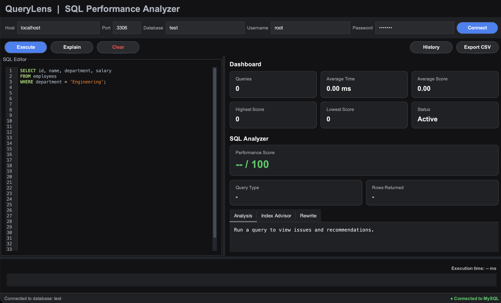
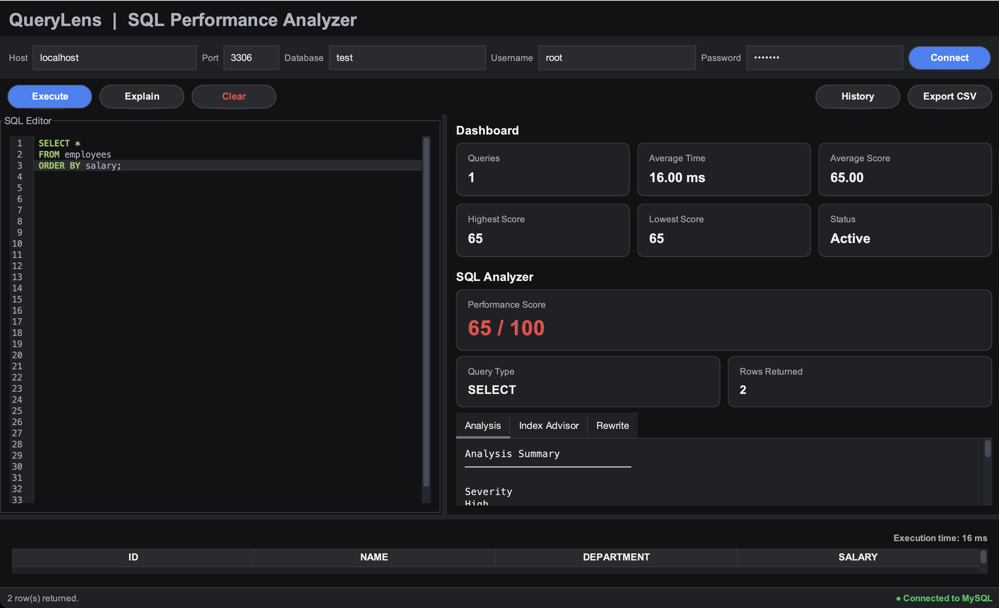
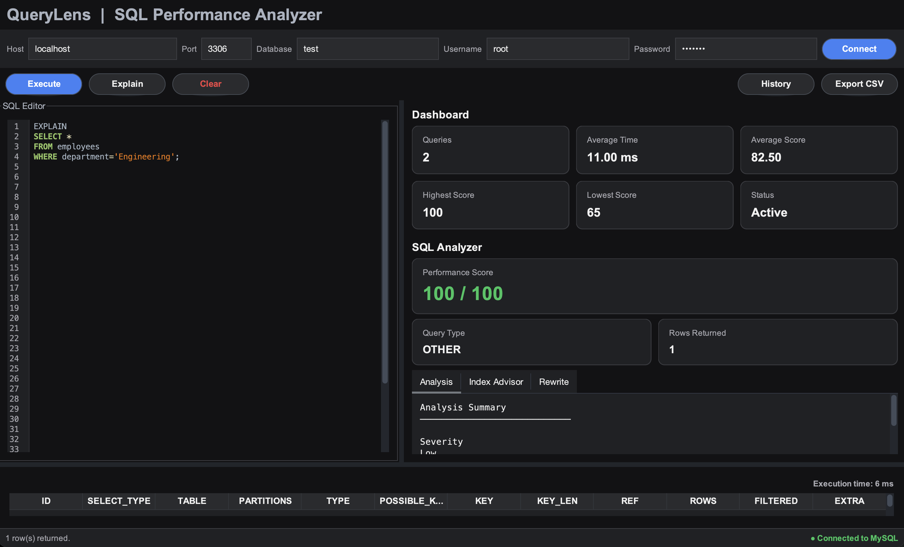
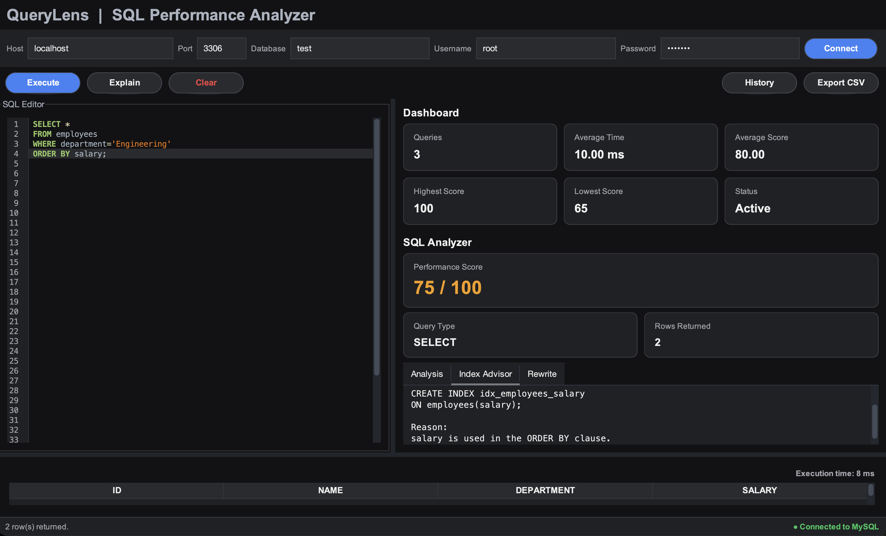
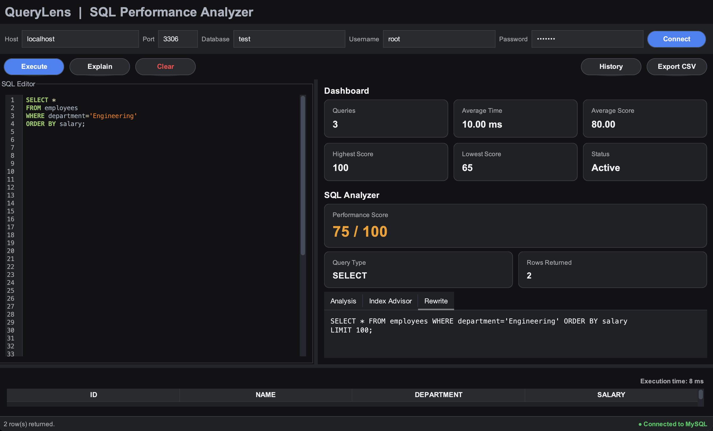
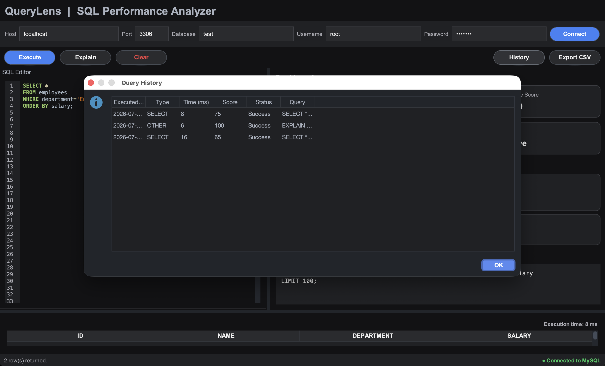

# QueryLens

> **Rule-Based SQL Performance Analyzer built with Java Swing, JDBC, and MySQL**

QueryLens is a desktop developer tool that helps identify inefficient SQL queries through static rule-based analysis and MySQL execution-plan inspection. It detects common SQL anti-patterns, assigns performance scores, recommends indexes, suggests safer query rewrites, tracks query history, and exports results to CSV.

## Preview




---

# Overview

Writing inefficient SQL queries can significantly impact application performance, especially as database size grows. QueryLens was built to help developers identify and understand common SQL performance issues before they become production bottlenecks.

Instead of executing complex optimizations automatically, QueryLens analyzes SQL queries using a rule-based engine, explains potential performance problems, recommends improvements, and visualizes execution statistics through an interactive desktop interface.

The application combines static SQL analysis with MySQL's `EXPLAIN` command to provide actionable recommendations that help developers write cleaner and more efficient SQL.

---

# ✨ Features

## 🔍 SQL Analysis Engine

- Detects common SQL anti-patterns using a modular rule engine.
- Assigns a performance score (0–100) based on detected issues.
- Categorizes findings by severity (Low, Medium, High, Critical).
- Provides detailed optimization recommendations for each detected issue.

### Supported SQL Rules

- `SELECT *` detection
- `DELETE` without `WHERE`
- `UPDATE` without `WHERE`
- `ORDER BY` without `LIMIT`
- `DISTINCT` usage analysis
- `SELECT` without `WHERE` or `LIMIT`
- Multiple `OR` condition detection
- `NOT IN` optimization detection
- `UNION` vs `UNION ALL`
- Leading wildcard `LIKE '%value'`
- `COUNT(*)` optimization analysis
- Functions applied on filtered columns

---

## 📊 Query Performance Analysis

- Executes SQL queries using JDBC.
- Measures execution time for every query.
- Displays query type automatically.
- Shows rows returned.
- Generates execution plans using MySQL `EXPLAIN`.

---

## 📈 Index Advisor

- Suggests indexes based on:
    - `WHERE` clauses
    - `JOIN` conditions
    - `ORDER BY`
    - `GROUP BY`

Example:

```sql
CREATE INDEX idx_employees_department_salary
ON employees(department, salary);
```

---

## ✨ Query Rewrite Suggestions

Suggests safer and more efficient SQL rewrites, including:

- Replacing `SELECT *` with explicit column names.
- Suggesting `LIMIT` for sorted result sets.
- Recommending `UNION ALL` when duplicate elimination is unnecessary.
- Highlighting inefficient filtering patterns.

---

## 📜 Query History

- Stores executed queries.
- Tracks execution time.
- Records performance score.
- Displays execution status.
- Calculates dashboard statistics.

---

## 📊 Interactive Dashboard

Displays:

- Total Queries Executed
- Average Execution Time
- Average Performance Score
- Highest Score
- Lowest Score

---

## 📁 Export

- Export query results to CSV.
- Suitable for reporting and further analysis.

---

## ⌨ Productivity Features

- Dark One Dark UI
- SQL syntax highlighting
- Query history
- Rounded modern interface
- Keyboard shortcut:
    - **Ctrl + Enter** (Windows/Linux)
    - **⌘ + Enter** (macOS)

---

# 📸 Application Screenshots

## 🏠 Main Dashboard

The primary workspace combines the SQL editor, dashboard, query results, and analyzer into a single interface.


---

## 🔍 SQL Rule Detection

Automatically detects inefficient SQL patterns, assigns a performance score, and provides optimization recommendations.



---

## 📊 EXPLAIN Query Analysis

Generates and displays MySQL execution plans using the `EXPLAIN` command to help understand query execution.



---

## 📈 Index Advisor

Analyzes filtering and sorting operations to recommend indexes that can improve query performance.



---

## ✨ Query Rewrite Suggestions

Suggests cleaner and more efficient SQL statements following optimization best practices.



---

## 🕒 Query History Dashboard

Maintains a history of executed queries along with execution time, score, and status.




---

# 🏗 Architecture

QueryLens follows a layered architecture to keep the user interface, business logic, and database operations independent and maintainable.

```text
                          +----------------------+
                          |      MainFrame       |
                          +----------+-----------+
                                     |
                +--------------------+--------------------+
                |                                         |
        ConnectionPanel                          EditorPanel
                |                                         |
                +--------------------+--------------------+
                                     |
                              QueryExecutor
                                     |
                    +----------------+----------------+
                    |                                 |
            SuggestionService                  HistoryService
                    |
        +-----------+-----------+
        |           |           |
   Rule Engine   Index Advisor  Query Rewriter
        |
   Individual SQL Rules
        |
        +--------------------------------------+
        |                                      |
  Static SQL Analysis                MySQL EXPLAIN
        |                                      |
        +-------------------+------------------+
                            |
                         MySQL Database
```

## Layer Responsibilities

### Presentation Layer

Responsible for all user interactions.

- Main application window
- SQL editor
- Result table
- Dashboard
- History dialog
- Connection manager

---

### Service Layer

Implements the application's business logic.

- Executes SQL queries
- Performs SQL analysis
- Generates optimization suggestions
- Maintains query history
- Calculates dashboard statistics

---

### Rule Engine

Analyzes SQL statements using independent optimization rules.

Each rule is isolated into its own class, making the analyzer easy to extend without modifying existing code.

---

### Database Layer

Communicates with MySQL using JDBC.

Supports:

- Query execution
- EXPLAIN plans
- Metadata retrieval

---

# 🧠 Rule Engine

QueryLens uses a modular rule-based engine to analyze SQL queries before execution. Each optimization rule is implemented as an independent class that follows a common interface, making the analyzer easy to extend and maintain.

## Rule Evaluation Flow

```text
                User SQL Query
                       │
                       ▼
              SuggestionService
                       │
                       ▼
          Iterate through all SQL Rules
                       │
     ┌─────────────────┼─────────────────┐
     │                 │                 │
     ▼                 ▼                 ▼
SelectStarRule   OrderByRule    DeleteWithoutWhereRule
     │                 │                 │
     └─────────────────┼─────────────────┘
                       │
             Collect Rule Violations
                       │
                       ▼
           Calculate Performance Score
                       │
                       ▼
              Generate Suggestions
                       │
                       ▼
              Display in Analyzer
```

## Implemented Rules

| Rule | Purpose |
|------|---------|
| SelectStarRule | Detects `SELECT *` usage |
| DeleteWithoutWhereRule | Prevents accidental full-table deletion |
| UpdateWithoutWhereRule | Detects unsafe updates |
| OrderByWithoutLimitRule | Identifies expensive sorting |
| DistinctRule | Suggests reviewing unnecessary duplicate removal |
| SelectWithoutWhereRule | Detects unrestricted data retrieval |
| MultipleOrRule | Identifies excessive OR conditions |
| NotInRule | Suggests alternative filtering approaches |
| UnionRule | Recommends `UNION ALL` when appropriate |
| LeadingWildcardLikeRule | Detects non-index-friendly LIKE patterns |
| CountRule | Reviews COUNT(*) usage |
| FunctionOnColumnRule | Detects functions applied to filtered columns |

---

# 📈 Performance Scoring

Every query starts with a score of **100**.

Each detected issue deducts points based on its impact.

Example:

| Issue | Penalty |
|--------|---------:|
| SELECT * | -15 |
| ORDER BY without LIMIT | -10 |
| Multiple OR conditions | -10 |
| Function on indexed column | -15 |

Final score:

```text
100
-15
-10
-10
------------
65 / 100
```

The final score is classified into severity levels:

| Score | Severity |
|-------:|----------|
| 90–100 | 🟢 Low |
| 70–89 | 🟡 Medium |
| 40–69 | 🟠 High |
| 0–39 | 🔴 Critical |

---

# 🛠 Tech Stack

| Category | Technologies |
|----------|--------------|
| Language | Java 21 |
| Desktop UI | Java Swing |
| SQL Editor | RSyntaxTextArea |
| Layout Manager | MigLayout |
| Database | MySQL 8 |
| Database Connectivity | JDBC |
| Build Tool | Maven |
| CSV Export | OpenCSV |
| Version Control | Git & GitHub |
| IDE | IntelliJ IDEA Community Edition |

---

# 📂 Project Structure

```text
QueryLens
│
├── screenshots/                 # README screenshots
│
├── src
│   ├── main
│   │   ├── java
│   │   │   └── com.rishika.sqlanalyzer
│   │   │       ├── model
│   │   │       ├── rules
│   │   │       ├── service
│   │   │       ├── database
│   │   │       ├── ui
│   │   │       ├── util
│   │   │       └── Main.java
│   │   │
│   │   └── resources
│   │       ├── icons
│   │       └── themes
│
├── pom.xml
├── README.md
└── LICENSE

```
---

# ⚙ Installation

## Prerequisites

- Java 21 or later
- Maven
- MySQL Server 8+
- IntelliJ IDEA (recommended)

## Clone the Repository

```bash
git clone https://github.com/<rishika150>/QueryLens.git
```

```bash
cd QueryLens
```

## Build the Project

```bash
mvn clean install
```

## Run the Application

```bash
mvn exec:java
```

Or simply open the project in IntelliJ IDEA and run:

```
Main.java
```
---

# 🚀 Usage

1. Launch the application.
2. Connect to a MySQL database.
3. Write or paste an SQL query.
4. Execute the query using the **Execute** button or **Ctrl/⌘ + Enter**.
5. Review:
    - Performance Score
    - Rule Violations
    - Index Recommendations
    - Query Rewrite Suggestions
    - Execution Plan (EXPLAIN)
6. Export results to CSV if required.
7. View previously executed queries in the Query History dashboard.

---

# 🚀 Future Enhancements

The current version focuses on rule-based SQL analysis and query optimization. Future versions may include:

- Query formatting and beautification
- Visual execution plan graphs
- Support for PostgreSQL and SQL Server
- User-defined custom SQL rules
- AI-assisted optimization suggestions
- Query comparison and benchmarking
- Query favorites and saved workspaces
- Dashboard analytics with charts
- Export reports to PDF
- Plugin-based rule engine for third-party extensions

---

# 📄 License

This project is licensed under the **MIT License**. See the [LICENSE](LICENSE) file for details.

---

# 👩‍💻 Author

**Rishika Sharan**

- B.Tech CSE (AI), Indira Gandhi Delhi Technical University for Women (IGDTUW)
- GitHub: https://github.com/rishika150
- LinkedIn: https://www.linkedin.com/in/rishika-sharan-9a3786292/

If you found this project useful, consider giving it a ⭐ on GitHub.